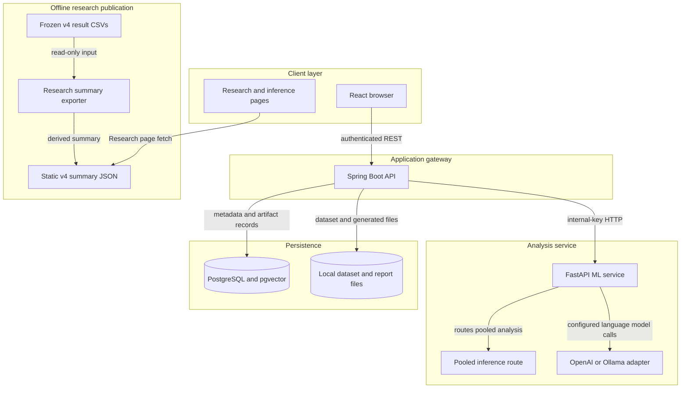
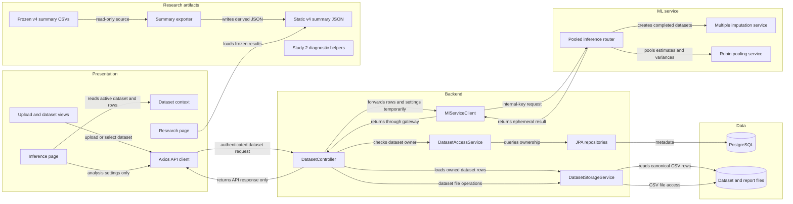

# Architecture Diagram

This map describes the current AI Data Analyst runtime and its separate offline research-results publication path. It highlights the existing seam between browser-held dataset rows and pooled inference so the integration plan can preserve the research baseline.

## Application Architecture

<!-- mermaid-checked: no \n, no em-dash/en-dash, no {} in labels, subgraphs are id["label"], arrows are -->|"label"|, all subgraphs closed by end, ids unique -->

### Technology Stack Summary

| Layer | Technology | Version | Purpose |
|---|---|---:|---|
| Client | React, React Router, Vite | 18.3.1, 6.26.0, 4.5.14 | Authenticated dataset workspace and analysis views |
| API gateway | Java and Spring Boot | 21, 3.3.3 | Authentication, dataset APIs, persistence coordination |
| ML service | Python, FastAPI, pandas, scikit-learn, statsmodels | Python 3.11; FastAPI 0.115.0 | Statistical analysis and ML endpoints |
| Persistence | PostgreSQL with pgvector | PostgreSQL 16 in Compose | User, dataset, and generated-analysis metadata |
| File storage | Local filesystem | Configured by `storage.local-path` | Uploaded CSVs and generated versions/reports |
| Research publication | CSV inputs, Python exporter, static JSON | v4 outputs; separate from runtime inference | Read-only research charts in the frontend |
| External AI | OpenAI or Ollama | Configured by environment | Chat and embedding features, not pooled statistical inference |

### Data Storage & External Services

The backend owns dataset metadata in PostgreSQL and reads or writes dataset and generated files through the configured local storage path. It calls FastAPI over an internal-key-protected HTTP boundary; optional OpenAI or Ollama calls are made by ML-service features. The Research page follows a separate offline path: the exporter reads frozen v4 CSV summaries and writes a static JSON asset served by the frontend. The current inference response is not persisted as an inference-history record.

### Key Architectural Decisions

- The browser calls Spring Boot rather than calling FastAPI directly.
- The frozen v4 research summaries are published as a static asset and are distinct from per-dataset runtime inference.
- Study 2 helpers and the performance-only feasibility benchmark are not runtime dependencies and do not provide validated Study 2 outcomes.

## Component Relationships

<!-- mermaid-checked: no \n, no em-dash/en-dash, no {} in labels, subgraphs are id["label"], arrows are -->|"label"|, all subgraphs closed by end, ids unique -->

### Component Inventory

| Component | Layer | Type | Responsibility |
|---|---|---|---|
| Upload and dataset views | Presentation | React pages and components | Upload CSVs and select saved datasets |
| Dataset context | Presentation | React context | Holds the active dataset ID, headers, and loaded rows |
| Inference page | Presentation | React page | Sends inference settings and displays returned estimates and intervals |
| Research page | Presentation | React page | Displays the published v4 summary asset |
| Axios API client | Presentation | HTTP client | Sends authenticated requests to the Spring Boot API |
| DatasetController | Backend | REST controller | Checks dataset access and routes analysis requests |
| DatasetAccessService | Backend | Service | Resolves the authenticated user and checks dataset ownership |
| MlServiceClient | Backend | HTTP client | Adds the internal key and calls FastAPI |
| DatasetStorageService | Backend | Service | Reads and writes dataset, version, and report files |
| JPA repositories | Backend | Persistence layer | Reads dataset ownership and metadata from PostgreSQL |
| Pooled inference router | ML service | FastAPI router | Validates an analysis request and assembles response metrics |
| Multiple imputation service | ML service | Analysis service | Builds completed numeric datasets for the inference request |
| Rubin pooling service | ML service | Statistical utility | Pools per-imputation estimates and variances |
| Frozen v4 summary CSVs | Research artifacts | Saved experimental outputs | Supplies the primary and exploratory research summary rows |
| Summary exporter | Research artifacts | Python script | Converts saved CSV rows to the frontend JSON schema |
| Static v4 summary JSON | Research publication | Static frontend asset | Supplies Research page chart data |
| Study 2 diagnostic helpers | Research artifacts | Experimental code | Supports implementation validation only; not a runtime dependency |

## Integration Findings

- The existing v4 results describe 10 OpenML-derived populations, 100 seeds per cell, one masked column, MCAR/MAR/MNAR, and nominal 95% interval coverage. The v4 sanity gate passed 20 of 20 checks, but the documented results also report undercoverage in important conditions; they do not justify a general calibrated-interval claim.
- Study 2 protocol 5.1 is still a pre-registration draft with blocking TODOs. Its 2026-11-01 benchmark is performance-only and reports no coverage, bias, or method ranking. Do not expose its candidate or benchmark projections as validated results.
- The inference API now accepts analysis settings only, authorizes the dataset, and loads canonical rows from its stored CSV. Client-supplied rows and unsupported settings are rejected.
- Inference output is ephemeral: it is returned in the API response, is not persisted, and can be downloaded by the user as CSV. There is no inference-history table or deletion-lifecycle change.
- The Research summary is read from static JSON, not from inference output or a live research API.
- A fixed-seed fixture comparison found no imputation parity: runtime `proper` and `improper` outputs differed from the v4 helper in all three compared draws. The seed streams and proper-bootstrap sampling rules differ; runtime also drops constant non-target columns while v4 retains numeric features. Both paths use the shared Rubin pooling utility, but this does not establish end-to-end equivalence. Runtime inference must not be described as reproducing v4.
- The runtime and v4 implementations remain separate; no experiment or result files were changed, and no Study 2 run was performed.

## Integration Plan

### Phase 1 - Research and inference integration

1. **Lock provenance.** Record the current v4 source files, checksums, environment, protocol, method definitions, and existing summary JSON schema. Treat v4 data and results as read-only. Do not execute Study 2 simulations: protocol 5.1 is still a draft and explicitly blocks inferential runs.
2. **Establish method parity.** Compare the runtime `proper` and `improper` implementations against the v4 experiment helpers on fixed, seeded fixtures. Verify the imputation count, observed-cell preservation, estimator/variance calculations, Rubin pooling, and returned intervals. If they differ, document the boundary and resolve it before making a v4-reproduction claim.
3. **Make inference dataset-bound.** Have the backend authorize the dataset and read its stored CSV; send only analysis settings from the browser. The ML request should receive canonical backend-loaded rows, validate the selected target/predictor and numeric input, and keep the existing response fields reproducible.
4. **Verify API behavior.** Add focused deterministic and edge-case tests for the ML contract, plus Spring-to-FastAPI integration coverage for dataset ownership, stored-row provenance, internal service authentication, failure mapping, and exact response shape. Preserve the current v4 artifacts and existing API behavior outside inference.
5. **Keep inference ephemeral.** Results are returned only in the API response and can be downloaded locally as CSV. Do not persist inference settings or results, create a history table, or change dataset deletion for inference.
6. **Phase 1 gate.** Verify upload, stored-data preprocessing, pooled inference, returned metrics, and deterministic replay through the API. Label interval results as model-dependent; do not claim calibrated coverage from the v4 evidence.

### Phase 2 - Frontend and product completion

1. Review the existing frontend changes as-is, then map each screen to its actual backend endpoint and request/response contract.
2. Wire the inference view to the dataset-bound API from Phase 1 and the Research view only to the frozen v4 summary asset unless new research results are separately authorized and validated.
3. Complete loading, empty, validation, error, success, and navigation behavior for the selected user workflows; remove placeholders only where a real backend capability exists.
4. Run frontend build and focused UI/API integration tests. Keep research experiment files, result directories, and unrelated page changes out of each small implementation batch.
