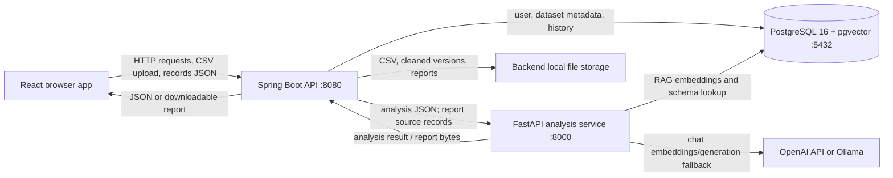
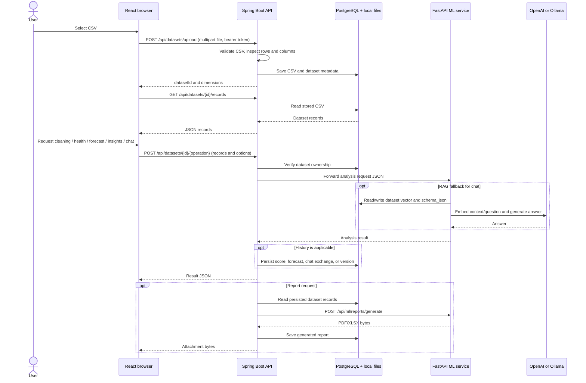
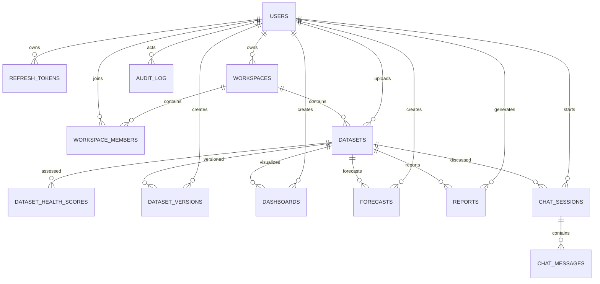

# AI Data Analyst - Project Documentation

This document describes the repository as implemented. “Configured” or
“present in the schema” does not necessarily mean a feature has a complete
user-facing workflow. Missing behavior is called out rather than inferred.

## 1. Project Overview

AI Data Analyst is a web application for uploading CSV files, inspecting data
quality, cleaning data, visualizing numeric columns, forecasting a time series,
generating summary insights, chatting with a dataset, and exporting reports.
The application has a React user interface, a Spring Boot API that handles
authentication and persistence, a Python FastAPI service for analysis, and a
PostgreSQL database.

The problem it addresses is bringing common data-preparation and analysis
operations into one interface rather than requiring users to write each
operation themselves. The code includes analyst-facing workflows; a formal
target-user statement is **Not found in code / TODO**. User roles named by the
backend are `ADMIN`, `ANALYST`, and `VIEWER`, but registration does not let the
user choose a role.

Implemented user-visible capabilities:

- Account registration, login, access-token refresh, and logout.
- CSV preview and upload, with records stored by the backend.
- Data quality score, assessment history, and user-adjustable quality weights.
- Missing-value filling, duplicate removal, outlier handling, repair logs, and
  cleaning-version restore.
- Line/bar charts for a limited number of rows.
- Time-series forecast with fixed model choices or automatic selection.
- Offline anomaly, trend, and correlation findings.
- Natural-language question answering with deterministic common-query handling
  and an LLM/RAG fallback.
- PDF and XLSX reports.

The front end currently keeps the selected dataset and its records in browser
memory; refreshing the page does not restore the selection from the database.
Dataset and workspace listing/selection flows are **Not found in code / TODO**.

## 2. Tech Stack

Versions below come from manifests, Dockerfiles, or the checked-in research
environment notes. Where a package is unpinned or inherited from a parent BOM,
that is stated rather than guessed.

| Area | Technology and version | Why it is present |
|---|---|---|
| Frontend | JavaScript, React `^18.3.1`, React DOM `^18.3.1` | Component-based browser UI. |
| Frontend routing | React Router DOM `^6.26.0` | Hash-based page routing in `frontend/src/App.jsx`. |
| Frontend HTTP | Axios `^1.7.4` | API calls and token interceptors. |
| Charts | Recharts `^2.12.7` | Line and bar chart rendering. |
| Frontend build | Vite `^4.5.14`, `@vitejs/plugin-react ^4.3.1` | Local development server and production bundling. |
| Frontend runtime image | Node `20-slim` build stage; Nginx `alpine` serving stage | Builds the static client and serves it in the frontend container. |
| Backend language | Java 21 | Spring Boot API and persistence layer. |
| Backend framework | Spring Boot `3.3.3` | Web endpoints, dependency injection, JPA, security, validation, and tests. |
| Backend build | Maven `3.9` image; Maven project | Dependency and executable-JAR build. |
| Backend web/security/data | Spring Boot Web, Data JPA, Security, Validation, WebSocket starters | HTTP APIs, database persistence, bearer authentication, request validation, and a declared WebSocket dependency. A WebSocket endpoint is **Not found in code / TODO**. |
| JWT | JJWT `0.12.5` (`api`, `impl`, `jackson`) | Signed access tokens. |
| Database driver | PostgreSQL JDBC, version managed by the Spring Boot parent | JPA database connectivity. |
| Backend tests | Spring Boot Test, version managed by the parent; JUnit 5 and Mockito APIs | Unit tests for selected services. |
| Database | PostgreSQL 16 with `pgvector/pgvector:pg16` image | Relational persistence and vector columns used by the RAG code. |
| ML service language/runtime | Python 3.11 in the service Dockerfile | Analysis microservice. |
| ML API | FastAPI `0.115.0`, Uvicorn standard extras `0.30.6`, Pydantic `2.8.2` | HTTP endpoints, ASGI serving, and typed request models. |
| ML data/science | pandas `2.2.2`, NumPy `1.26.4`, scikit-learn `1.5.1`, statsmodels `0.14.2` | Dataframes, numeric operations, imputers/outlier models, and time-series methods. |
| ML integrations/output | `python-multipart 0.0.9`, ReportLab, openpyxl, OpenAI Python client, psycopg binary extra, httpx | Multipart support is a dependency; ReportLab/openpyxl create PDF/XLSX; OpenAI and Ollama integrations are used for LLM/RAG; psycopg and httpx support direct database and HTTP calls. These latter dependency versions are unpinned in `ml-service/requirements.txt`. |
| ML tests | pytest and SciPy in `ml-service/requirements-dev.txt` | Test runner and statistical functions used by tests. |
| Experiment environment | Python `3.13.9` in the checked-in experiment instructions; NumPy `2.3.5`, pandas `2.3.3`, scikit-learn `1.7.2`, SciPy `1.16.3`, statsmodels `0.14.5`, tabulate `0.9.0` in experiment pins | Reproducible, separate research/benchmark runs. |
| Containers | Dockerfiles for all three runtime components; Docker Compose file format `3.9` | Local multi-service build and orchestration. |
| External services | OpenAI API (optional, credential required) or Ollama (optional local endpoint); OpenML for real-dataset experiments | LLM embeddings/generation and experiment dataset fetching. |

`frontend/package.json` declares the supported Node engine range as `>=16.0.0
<19.0.0`, while `frontend/Dockerfile` builds with Node 20. This version mismatch
is present in the repository; compatibility is not verified here.

## 3. System Architecture

The browser is intended to call Spring Boot only. Spring owns identity checks,
dataset ownership checks, file/database persistence, and orchestration. FastAPI
implements analysis operations. PostgreSQL stores metadata and analysis history;
the original CSVs, cleaned versions, and generated reports are written to the
backend's local filesystem path.

Most analysis requests are different from the simplified comments in a few
service files: the React client sends its in-memory `records` as JSON to Spring,
and Spring forwards that request body to FastAPI. The backend does not reload
the stored CSV for cleaning, quality scoring, forecasting, insights, or chat.
Reports are the exception: the Spring report service reads the stored dataset
before calling FastAPI. The RAG chat fallback also connects directly from the
ML service to PostgreSQL to read/write embeddings and retrieve `schema_json`.



The FastAPI application enables CORS for all origins. The frontend itself uses
the Spring gateway and does not directly call FastAPI.

## 4. Folder / Module Structure

```text
.
├── README.md                         Project entry point and research overview
├── .env.example                      Compose/ML example settings (dummy values)
├── docker-compose.yml                PostgreSQL, ML, backend, and frontend services
├── db/
│   └── schema.sql                    PostgreSQL and pgvector schema
├── backend/
│   ├── Dockerfile                    Maven build and Java runtime image
│   ├── pom.xml                       Java version, Spring, JWT, PostgreSQL, test dependencies
│   └── src/
│       ├── main/java/com/aidataanalyst/
│       │   ├── Application.java      Spring Boot entry point and bounded HTTP client
│       │   ├── controller/           AuthController, DatasetController, UploadController
│       │   ├── dto/                  Login/register/refresh/auth response records
│       │   ├── entity/               User, workspace, dataset and analysis entities
│       │   ├── repository/           Spring Data JPA repositories
│       │   ├── security/             JWT filter/service and stateless security configuration
│       │   └── service/              Auth, dataset storage/access, ML, report, history services
│       ├── main/resources/
│       │   └── application.yml       Backend port, database, timeouts, JWT, storage defaults
│       └── test/java/                CSV parser, dataset access, and health persistence tests
├── frontend/
│   ├── Dockerfile                    Vite build and Nginx runtime image
│   ├── nginx.conf                    Static SPA serving and `/api/` proxy to Spring
│   ├── package.json                  Frontend scripts and dependencies
│   ├── vite.config.js                Dev port and Spring API proxy
│   └── src/
│       ├── App.jsx                   Hash routes, navigation, protected route wrapper
│       ├── main.jsx                  React root and global stylesheet entry
│       ├── api/
│       │   ├── client.js             Axios client, token refresh, dataset API methods
│       │   ├── auth.js               Register/login/logout helpers
│       │   └── DatasetContext.jsx    In-memory current dataset and CSV parsing
│       ├── pages/                    Upload, Overview, Cleaning, Visualization, Forecasting,
│       │                              Insights, Chat, Reports, Login, Register
│       └── styles.css                Global dark theme and layout styles
├── ml-service/
│   ├── Dockerfile                    Python 3.11 image and Uvicorn entry command
│   ├── requirements.txt              Runtime Python dependencies
│   ├── requirements-dev.txt          Runtime requirements plus test/development packages
│   ├── pytest.ini                    pytest import and test discovery settings
│   └── app/
│       ├── main.py                   FastAPI app, CORS, router registration, root health response
│       ├── models/schemas.py         Request schemas for records, cleaning, forecasting, chat
│       ├── routers/                  HTTP adapters for health, cleaning, stats, forecast,
│       │                              insights, chat, and reports
│       └── services/                 Analysis, imputation, LLM/RAG, stats, and report logic
├── experiments/
│   ├── README.md                     Reproducibility protocols, caveats, commands, results links
│   ├── requirements.txt              Separate research environment pins
│   ├── environment_pins.txt          Notes about experiment dependency pins
│   ├── common.py                     Shared output, environment capture, Holm adjustment
│   ├── datasets/
│   │   ├── registry.py               Verified OpenML metadata, cache, retries, manifest helpers
│   │   ├── manifest.json             Tracked dataset metadata and checksums
│   │   └── metadata/                 Per-dataset feature-type sidecars
│   ├── benchmark and table scripts   Imputation, forecasting, MNAR/DQ, real-dataset runs,
│   │                                  MICE ablations, and generated summary/table builders
│   ├── tests/                        Offline experiment, loader, protocol, and table tests
│   └── results/                      Checked-in CSV/JSON/log/report evidence from frozen runs
├── research/
│   ├── README.md                     Research evidence index
│   ├── research-matrix.md            Literature-to-code mapping and limitations
│   ├── research-upgrade-status.md    Implemented work versus measured claims
│   └── implementation-roadmap.md     Evidence-based open evaluation priorities
└── reports/
    ├── project-audit.md              Existing project audit notes
    ├── research-upgrade-comparison.md Existing comparison report
    └── research-upgrade-gap-analysis.md Existing gap analysis
```

Important backend files:

| Files | Purpose |
|---|---|
| `backend/src/main/java/com/aidataanalyst/controller/AuthController.java` | Registration, login, refresh rotation, and logout endpoints. |
| `backend/src/main/java/com/aidataanalyst/controller/UploadController.java` | CSV upload validation, row/column inspection, default workspace creation, metadata save. |
| `backend/src/main/java/com/aidataanalyst/controller/DatasetController.java` | Ownership-gated dataset operations and orchestration endpoints. |
| `backend/src/main/java/com/aidataanalyst/service/CsvParser.java`, `backend/src/main/java/com/aidataanalyst/service/DatasetStorageService.java` | CSV parsing, safe-path checks, local file read/write, and record conversion. |
| `backend/src/main/java/com/aidataanalyst/service/MlServiceClient.java` | Spring-to-FastAPI JSON requests and ML timeout mapping. |
| `backend/src/main/java/com/aidataanalyst/service/VersioningService.java` | Cleaning version creation/list/restore. |
| `backend/src/main/java/com/aidataanalyst/service/ReportGenerationService.java` | Stored CSV to ML report request, report persistence, binary download response. |
| `backend/src/main/java/com/aidataanalyst/security/` | JWT validation and stateless request authentication. |
| `backend/src/main/java/com/aidataanalyst/entity/` | `User.java` and `RefreshToken.java` model identity; `Workspace.java` and `Dataset.java` model ownership/data; `DatasetHealthScore.java` and `DatasetVersion.java` model quality/version history; `Forecast.java`, `Report.java`, `ChatSession.java`, and `ChatMessage.java` model analysis outputs and conversations. |
| `backend/src/main/java/com/aidataanalyst/repository/` | Repository classes with matching entity names (`UserRepository.java`, `RefreshTokenRepository.java`, `WorkspaceRepository.java`, `DatasetRepository.java`, `DatasetVersionRepository.java`, `DatasetHealthScoreRepository.java`, `ForecastRepository.java`, `ReportRepository.java`, `ChatSessionRepository.java`, `ChatMessageRepository.java`) provide Spring Data queries. |

Important ML files:

| Files | Purpose |
|---|---|
| `ml-service/app/main.py`, `ml-service/app/models/schemas.py` | API composition, CORS, and request contracts. |
| `ml-service/app/routers/*.py` | Thin endpoint handlers; modules are `health`, `cleaning`, `stats`, `forecasting`, `insights`, `chat`, and `reports`. |
| `ml-service/app/services/cleaning_service.py` | Missing-data strategies, duplicate removal, outlier handling, type helpers, repair summary. |
| `ml-service/app/services/health_service.py` | Weighted quality score, sentinel checks, and missingness signals. |
| `ml-service/app/services/forecasting_service.py` | Time-series preparation, candidate models, rolling backtests, MASE-based selection. |
| `ml-service/app/services/chat_service.py`, `ml-service/app/services/rag_service.py`, `ml-service/app/services/llm_provider.py` | Deterministic question routing and optional embedding/generation fallback. |
| `ml-service/app/services/insights_service.py`, `ml-service/app/services/stats_service.py`, `ml-service/app/services/report_service.py` | Offline findings, descriptive statistics, PDF/XLSX export. |

Experiment entry points include `experiments/imputation_benchmark.py`,
`experiments/imputation_research_benchmark.py`,
`experiments/forecasting_benchmark.py`,
`experiments/forecasting_research_benchmark.py`,
`experiments/run_real_datasets.py`, `experiments/run_stage.py`,
`experiments/run_mice_ablation.py`, `experiments/dq_sensitivity_benchmark.py`,
and `experiments/mnar_detector_benchmark.py`. The `experiments/make_*.py`
scripts turn saved benchmark outputs into tables/reports;
`experiments/results/` holds evidence, not
application runtime data. There are no tracked Jupyter notebooks.

## 5. End-to-End Workflow

1. A user registers or signs in. The backend validates the request, stores a
   BCrypt password hash, and returns a signed access token plus an opaque
   refresh token. The frontend stores both tokens in `localStorage`.
2. The browser reads the selected CSV for a local preview using
   `frontend/src/api/DatasetContext.jsx`. The backend separately receives the multipart file at
   `/api/datasets/upload`, validates the extension and CSV shape, writes the
   original bytes to local storage, and saves dataset metadata in PostgreSQL.
3. The browser calls `GET /api/datasets/{id}/records` to load persisted records
   and then keeps them in the in-memory React context.
4. On analysis actions, the browser sends its current `records` plus options to
   a Spring endpoint. Spring authenticates the user and verifies that the user
   uploaded that dataset.
5. Spring sends most analysis request bodies to the matching FastAPI endpoint.
   The Python service builds a pandas DataFrame, runs the selected analysis,
   and returns JSON. Spring returns the result to the browser and selectively
   persists history (health checks, forecasts, chats, cleaning versions).
6. For report generation, Spring reads records from its stored CSV, calls the
   FastAPI report endpoint, saves the returned file, and streams it to the
   browser as an attachment.
7. For unrecognized chat questions, FastAPI can embed context and query
   PostgreSQL's vector columns, then call the configured OpenAI or Ollama
   provider. That chat fallback has a direct ML-service-to-PostgreSQL connection.



## 6. Frontend Details

### Pages and routes

`frontend/src/App.jsx` uses `HashRouter`. A `ProtectedRoute` checks only whether
`localStorage` contains `jwt`; it does not validate token expiry itself. The
Axios interceptor handles a protected API `401` by attempting one coalesced
refresh request, rotating the tokens, retrying once, then clearing the client
session and navigating to login if refresh fails.

| Route | Page | Behavior |
|---|---|---|
| `/` | `frontend/src/pages/Upload.jsx` | Local CSV preview, upload, load records back from backend. |
| `/overview` | `frontend/src/pages/Overview.jsx` | Row/column counts, quality score, editable score weights, history and findings. |
| `/cleaning` | `frontend/src/pages/Cleaning.jsx` | Imputation/outlier choices, cleaning result, repair log, version list and restore. |
| `/visualization` | `frontend/src/pages/Visualization.jsx` | Select x/y columns, render line or bar chart. Uses at most 200 rows. |
| `/forecasting` | `frontend/src/pages/Forecasting.jsx` | Choose date/value columns, horizon and model; show forecast and model comparison. |
| `/insights` | `frontend/src/pages/Insights.jsx` | Request and display offline anomalies, trends, and correlations. |
| `/chat` | `frontend/src/pages/Chat.jsx` | Send a question with the current records and show returned answer. |
| `/reports` | `frontend/src/pages/Reports.jsx` | Request PDF/XLSX report and provide a browser download link. |
| `/login` | `frontend/src/pages/Login.jsx` | Sign-in form. |
| `/register` | `frontend/src/pages/Register.jsx` | Account creation form. |

### State and API calls

- `frontend/src/api/DatasetContext.jsx` holds `fileName`, `headers`, `records`, and `datasetId`
  using React state. It is not persisted across browser reloads.
- Its CSV parser supports quoted cells, escaped quote characters, CR/LF, and
  multiline fields. It validates empty headers and unterminated quoted cells;
  it does not reject rows with more or fewer cells than the header.
- `frontend/src/api/client.js` sets the base path to `/api`, attaches access tokens, and
  exposes helpers for cleaning, quality score/history, forecasts, insights,
  and chat. Upload, records, versions, restore, and reports call the Axios
  client directly from page components.
- `frontend/src/api/auth.js` wraps registration/login and stores returned tokens. Logout
  removes local tokens immediately, then best-effort calls backend revocation.
  A logout control is not present in the listed navigation.
- In development, Vite runs on port `5173` and proxies `/api` to
  `http://localhost:8080`. In the container, Nginx serves the SPA on port 80
  and proxies `/api/` to the backend.

## 7. Backend Details

### Controllers and services

- `backend/src/main/java/com/aidataanalyst/controller/AuthController.java` exposes unauthenticated registration, login, refresh, and
  logout operations under `/api/auth`.
- `backend/src/main/java/com/aidataanalyst/controller/UploadController.java` accepts CSV files, rejects empty files/non-CSV extensions,
  parses the file to count rows and columns, creates a default owner workspace
  when absent, writes the original CSV to local storage, and inserts dataset
  metadata.
- `backend/src/main/java/com/aidataanalyst/controller/DatasetController.java` exposes ownership-gated dataset operations. The
  `backend/src/main/java/com/aidataanalyst/service/DatasetAccessService.java` resolves the current user by email and queries dataset
  ownership by both dataset ID and uploader ID. A non-owned/missing dataset is
  returned as not found.
- `backend/src/main/java/com/aidataanalyst/service/MlServiceClient.java` calls FastAPI with JSON and configured connect/read
  timeouts. Resource-access timeout failures are mapped to HTTP 504. Other
  downstream failures are not normalized by a global exception handler.
- `backend/src/main/java/com/aidataanalyst/service/VersioningService.java`,
  `backend/src/main/java/com/aidataanalyst/service/DatasetHealthScorePersistenceService.java`,
  `backend/src/main/java/com/aidataanalyst/service/ForecastPersistenceService.java`,
  `backend/src/main/java/com/aidataanalyst/service/ChatPersistenceService.java`,
  and `backend/src/main/java/com/aidataanalyst/service/ReportGenerationService.java`
  persist the corresponding records/results.
- `backend/src/main/java/com/aidataanalyst/service/DatasetStorageService.java` uses a local filesystem root and checks normalized
  paths stay beneath that root. It stores original uploads, CSV versions and
  generated reports.
- `backend/src/main/java/com/aidataanalyst/service/CsvParser.java` handles standard quoted CSV fields, escaped quotes, line breaks,
  and an initial UTF-8 BOM; it rejects unterminated quoted fields.

### Security and error behavior

- Spring Security is stateless, disables CSRF, permits `/api/auth/**`, and
  requires authentication for other backend routes.
- Passwords are BCrypt encoded. Access tokens are signed JWTs; refresh tokens
  are random opaque tokens whose SHA-256 hashes are stored server-side and
  rotated after use.
- `backend/src/main/java/com/aidataanalyst/security/JwtService.java` signs and
  validates access tokens; `backend/src/main/java/com/aidataanalyst/security/RefreshTokenService.java`
  issues, rotates, hashes, and revokes refresh tokens.
- `backend/src/main/java/com/aidataanalyst/dto/RegisterRequest.java` and
  `backend/src/main/java/com/aidataanalyst/dto/LoginRequest.java` require a
  nonblank, valid-format email and nonblank password. Registration additionally
  enforces password length 8-128 and optional full-name maximum length 255.
- Dataset access is checked against uploader ownership, not merely an ID.
- There is no global Spring exception response format handler. Controllers and
  services use validation exceptions and `ResponseStatusException` for many
  expected failures.
- The ML service is not independently authenticated by Spring credentials;
  Compose network routing is the only service boundary shown. FastAPI CORS is
  wildcard-enabled. Restrict service networking/CORS and add service
  authentication before exposing these ports in a production environment.
- A development placeholder is configured for the JWT signing secret in
  `backend/src/main/resources/application.yml`; PostgreSQL credentials also
  have development defaults in configuration. Their literal values are
  intentionally not reproduced here. Supply strong external secrets for any
  shared or production deployment.

### Important behavior and gaps

- Upload metadata includes filename, row count, column count, uploader, workspace,
  and storage path. `schema_json` is not set by the upload path.
- Cleaning results are stored as a new version file and version row. The
  original dataset file is not replaced by a cleaning request; the browser
  displays the returned cleaned records. Restore writes a selected version's
  records back to the original dataset storage path.
- Health assessments update the dataset's current score and append history.
- Forecast and chat results are persisted, but no backend read/list endpoint
  for forecast records, chat transcripts, or reports is wired to the UI.
- `backend/src/main/java/com/aidataanalyst/service/MlServiceClient.java` contains methods only for cleaning, quality score,
  forecasting, insights, and chat. Stats and cleaning type-suggestion/type-
  conversion FastAPI routes have no Spring gateway mapping.

## 8. ML / NLP / Data Pipeline

There are no checked-in trained model files, model-training jobs, or model
evaluation service endpoints. This is an analysis service using library
algorithms plus optional LLM calls.

### Cleaning and type handling

`ml-service/app/services/cleaning_service.py` supports:

- `auto`: median fill for numeric columns, mode for other columns.
- `knn`: scikit-learn KNN imputation with five neighbors for usable numeric
  columns; nonnumeric columns fall back to mode.
- `multiple`: repeated feature-aware iterative imputation using
  `IterativeImputer` with `BayesianRidge`, posterior sampling, five draws,
  ten iterations, and observed-value bounds when at least two numeric features
  are usable and the numeric matrix is within its cell limit. Otherwise a
  marginal bootstrap fallback is used. Categorical columns use mode.
- Optional custom strategies in the service: mean, median, mode, zero, or drop
  for named columns.
- IQR capping or Isolation Forest-based multivariate outlier capping.
- Type-conversion suggestion and conversion endpoints.
- A bounded repair log (up to 500 records in the HTTP response).

The displayed multiple-imputation spread is between-draw variation; the
repository explicitly says it has not been demonstrated to be a calibrated
prediction interval. The service's type conversion helper catches conversion
exceptions and continues, and type-conversion routes are not used by the
current UI.

### Quality scoring

`ml-service/app/services/health_service.py` combines completeness, uniqueness, consistency, and
outlier scores with default weights `0.35`, `0.25`, `0.20`, and `0.20`.
Custom weights must contain exactly those four keys, be finite/nonnegative, and
sum approximately to one. Grades use thresholds from A (90+) down to F
(below 45). It counts selected string/numeric sentinel values and can emit
possible informative-missingness signals based on correlations or row-order
halves. The signal is a heuristic; it cannot identify MNAR from observed data
alone.

### Forecasting

`ml-service/app/services/forecasting_service.py` validates and sorts date/value observations, rejects
invalid dates, nonnumeric/infinite values, and duplicate timestamps, and needs
at least ten usable points. Implemented candidates are naive, seasonal naive,
Holt, ARIMA `(1,1,1)`, SARIMA, and an equal-weight ensemble. Seasonal cycle
length is inferred from common timestamp spacing. In `auto`, a shortlist is
evaluated over up to three rolling-origin splits (two for very large series);
the candidate with finite MASE on each split and the lowest average MASE wins.
If there is no comparable score, the naive baseline is returned without
claiming a model-selection result. The API accepts horizons from 1 to 365.
MAPE, RMSE, and MASE are returned for backtested candidates; fixed model
requests return the selected forecast without a model comparison.

### Insights, chat, and RAG

- Offline insights use IQR outlier counts, date-like column comparisons for
  trend direction, and top absolute numeric correlations. The UI requests
  `use_llm: false`.
- `generate_llm_summary` in `ml-service/app/services/insights_service.py` is a deterministic narration
  over computed findings, not a call to an external LLM. Despite request
  schema options, the inspected implementation does not route insight
  generation to OpenAI or Gemini.
- Chat handles common average/mean, sum, max/min, row-count, and top-N patterns
  directly against the DataFrame. Other questions call `rag_service`.
- `ml-service/app/services/rag_service.py` builds a bounded context from schema and up to 20 sample
  rows, prefers question-mentioned columns within a 15-column budget, uses a
  provider-specific embedding vector column, and calls OpenAI or Ollama based
  on `LLM_PROVIDER`. The service code connects directly to PostgreSQL using
  `psycopg`, despite the ML service module-level description saying the service
  does not talk to the database.
- Upload currently does not populate `datasets.schema_json`. Therefore the
  RAG retrieval query may have no schema JSON to retrieve for uploaded data;
  current request context still includes a sample from the records supplied
  with that chat request. The RAG service also catches broad exceptions and
  returns a generic unavailable answer.

### Experiments and datasets

`experiments/datasets/registry.py` defines 15 OpenML dataset specifications,
records data IDs/versions/types/checksums in manifests, verifies local caches,
and retries retryable network failures. The optional real-dataset benchmark has:

- Protocol A: controlled MCAR/MAR/MNAR ground-truth masking and reconstruction
  scoring.
- Protocol B: natural-missingness folds with predictive and held-out observed
  cell measurements.
- Separate numeric and categorical metrics; categorical ordinal encoding is a
  benchmark adapter and does not represent production mixed-type MICE support.

Other scripts benchmark bundled-dataset imputation and forecasting, a
missingness-signal heuristic, score sensitivity to injected corruptions, and
MICE/forecasting ablations. The `experiments/README.md`,
`research/research-matrix.md`, and `research/implementation-roadmap.md`
document design, reported evidence, and limitations.

The tagged follow-up report
`experiments/results/mice_ablation_followup_2026-10-21/ABLATION_FOLLOWUP_SUMMARY.md`
labels its results post-hoc and descriptive. It reports corrected nominal-0.90
coverage medians from a five-dataset exploratory subset; those medians vary by
missingness mechanism and are not uniformly nominal. The report notes that
previous saved m=20/m=50 coverage values used an m=5 quantile and were
overstated; its corrected recalculation is not a new significance claim.

## 9. API Reference

All `/api/...` endpoints on Spring Boot require a bearer access token except
`/api/auth/**`. The FastAPI endpoints below are internal service routes in the
intended architecture, but the FastAPI app has no authentication middleware.

### Spring Boot API (`:8080`)

| Method and URL | Request | Response | Handler |
|---|---|---|---|
| `POST /api/auth/register` | JSON: `email`, `password`, optional `fullName` | `201`; `token`, `refreshToken`, `email`, `fullName`, `role` | `backend/src/main/java/com/aidataanalyst/controller/AuthController.java` |
| `POST /api/auth/login` | JSON: `email`, `password` | `200`; same `AuthResponse` fields | `backend/src/main/java/com/aidataanalyst/controller/AuthController.java` |
| `POST /api/auth/refresh` | JSON: `refreshToken` | `200`; new access and rotated refresh tokens plus user fields | `backend/src/main/java/com/aidataanalyst/controller/AuthController.java` |
| `POST /api/auth/logout` | JSON: `refreshToken` | `200`; message | `backend/src/main/java/com/aidataanalyst/controller/AuthController.java` |
| `POST /api/datasets/upload` | Multipart field `file`; must have `.csv` filename and nonempty content | `201`; `datasetId`, `fileName`, `rowCount`, `columnCount` | `backend/src/main/java/com/aidataanalyst/controller/UploadController.java` |
| `GET /api/datasets/{id}/records` | No body | Array of row objects, loaded from stored CSV | `backend/src/main/java/com/aidataanalyst/controller/DatasetController.java` |
| `POST /api/datasets/{id}/clean` | `records`, optional `strategy`, `custom_strategies`, `remove_duplicates`, `outlier_method`, `outlier_columns` | `cleaned_records`, `summary`, `repair_log`, optional truncation marker | `backend/src/main/java/com/aidataanalyst/controller/DatasetController.java` |
| `POST /api/datasets/{id}/health-score` | `records`; optional `weights` | Score, grade, component scores, issues, sentinel count, weights, missingness signals, trend fields | `backend/src/main/java/com/aidataanalyst/controller/DatasetController.java` |
| `GET /api/datasets/{id}/health-score/history` | No body | Up to 100 newest score entities | `backend/src/main/java/com/aidataanalyst/controller/DatasetController.java` |
| `POST /api/datasets/{id}/forecast` | `records`, `date_column`, `value_column`, optional `periods` (default 30 at ML schema), `model` | Model forecast; auto mode also includes comparison, features, candidates, and backtest metadata | `backend/src/main/java/com/aidataanalyst/controller/DatasetController.java` |
| `POST /api/datasets/{id}/insights` | `records`; optional `focus_columns`, `use_llm`, `llm_provider` | `insights` and `executive_summary` | `backend/src/main/java/com/aidataanalyst/controller/DatasetController.java` |
| `POST /api/datasets/{id}/chat` | `records`, `question`; browser also sends `dataset_id`; optional `history` | Chat object, usually `answer` and optional numeric/record fields | `backend/src/main/java/com/aidataanalyst/controller/DatasetController.java` |
| `GET /api/datasets/{id}/versions` | No body | Newest-first version entities with version number, operation, parameters, summary, and timestamp | `backend/src/main/java/com/aidataanalyst/controller/DatasetController.java` |
| `POST /api/datasets/{id}/versions/{versionNumber}/restore` | No body | `versionNumber` and restored `records` | `backend/src/main/java/com/aidataanalyst/controller/DatasetController.java` |
| `POST /api/datasets/{id}/reports` | JSON: `format` (`PDF` or `XLSX`) | Binary attachment, stored as a report record | `backend/src/main/java/com/aidataanalyst/controller/DatasetController.java` |

Error codes depend on Spring validation/security and `ResponseStatusException`
paths: invalid upload is 400, unauthenticated access is 401, missing or
non-owned datasets are 404, and invalid ML health response is 502. Exact error
JSON is not normalized by a repository-wide handler.

### FastAPI service API (`:8000`)

All analysis requests generally use `{ "records": [ { "column": "value" } ] }`
plus endpoint-specific fields. This service is called by Spring in the current
architecture. The stats and type routes are present but are not exposed through
Spring endpoints or used by the frontend.

| Method and URL | Additional request fields | Response / behavior | Handler |
|---|---|---|---|
| `GET /` | None | Service name and status object | `ml-service/app/main.py` |
| `POST /api/ml/health/score` | Optional `weights`, `previous_score` | Quality score object; invalid weights return 400 | `ml-service/app/routers/health.py` |
| `POST /api/ml/cleaning/clean` | Optional `strategy`, `custom_strategies`, `remove_duplicates`, `outlier_method`, `outlier_columns` | `cleaned_records`, `summary`, up to 500 `repair_log` entries | `ml-service/app/routers/cleaning.py` |
| `POST /api/ml/cleaning/suggest-types` | None | `suggestions` by column | `ml-service/app/routers/cleaning.py` |
| `POST /api/ml/cleaning/convert-types` | `conversions` map | Converted `records` | `ml-service/app/routers/cleaning.py` |
| `POST /api/ml/stats/numeric` | None | Numeric `describe()` statistics plus median, skewness, kurtosis | `ml-service/app/routers/stats.py` |
| `POST /api/ml/stats/categorical` | None | Unique count, top value, and up to ten category frequencies per column | `ml-service/app/routers/stats.py` |
| `POST /api/ml/stats/correlation` | None | `correlation` matrix, or null when fewer than two numeric columns | `ml-service/app/routers/stats.py` |
| `POST /api/ml/forecasting/run` | `date_column`, `value_column`, `periods` (1-365, default 30), `model` | Forecast plus auto-selection/model metrics when applicable; invalid data returns 400 | `ml-service/app/routers/forecasting.py` |
| `POST /api/ml/insights/generate` | Optional `focus_columns`, `use_llm`, `llm_provider` | `insights`, `executive_summary` | `ml-service/app/routers/insights.py` |
| `POST /api/ml/chat/ask` | `dataset_id`, `question`, optional `history` | Answer object, may include a `value` or top rows | `ml-service/app/routers/chat.py` |
| `POST /api/ml/reports/generate` | `format` (`PDF`/`XLSX`), optional `dataset_name` | Binary file response with attachment header | `ml-service/app/routers/reports.py` |

FastAPI's generated OpenAPI UI is available at `/docs` when the service is
running. `/openapi.json` is framework-generated, not a separately implemented
business endpoint.

## 10. Database Design

The authoritative DDL is `db/schema.sql`. It creates PostgreSQL tables,
foreign keys, indexes, and the `vector` extension.
`backend/src/main/resources/application.yml` configures
Hibernate `ddl-auto: update` as well; schema evolution is not represented by a
versioned migration tool.

| Table | Columns (primary key marked `PK`; foreign keys marked `FK`) |
|---|---|
| `users` | `id PK`, `email` (unique), `password_hash`, `full_name`, `role`, `created_at` |
| `refresh_tokens` | `id PK`, `user_id FK`, `token_hash` (unique), `expires_at`, `revoked`, `created_at` |
| `workspaces` | `id PK`, `name`, `owner_id FK`, `created_at` |
| `workspace_members` | `workspace_id FK`, `user_id FK`, `role`; composite primary key `(workspace_id, user_id)` |
| `datasets` | `id PK`, `workspace_id FK`, `uploaded_by FK`, `file_name`, `storage_path`, `row_count`, `column_count`, `schema_json`, `health_score`, `schema_embedding_openai vector(1536)`, `schema_embedding_ollama vector(768)`, `created_at` |
| `dataset_health_scores` | `id PK`, `dataset_id FK`, `score` (0-100 check), `grade`, `assessed_at` |
| `dataset_versions` | `id PK`, `dataset_id FK`, `version_number`, `storage_path`, `operation`, `operation_params`, `diff_summary`, `created_by FK`, `created_at`; unique `(dataset_id, version_number)` |
| `dashboards` | `id PK`, `dataset_id FK`, `created_by FK`, `title`, `layout_json`, `is_shared`, `share_token` (unique), `created_at` |
| `forecasts` | `id PK`, `dataset_id FK`, `date_column`, `value_column`, `model_used`, `model_comparison`, `forecast_json`, `created_by FK`, `created_at` |
| `reports` | `id PK`, `dataset_id FK`, `format`, `storage_path`, `generated_by FK`, `scheduled`, `cron_expression`, `created_at` |
| `chat_sessions` | `id PK`, `dataset_id FK`, `user_id FK`, `created_at` |
| `chat_messages` | `id PK`, `session_id FK`, `role`, `content`, `created_at` |
| `audit_log` | `id PK`, nullable `user_id FK`, `action`, `entity_type`, `entity_id`, `metadata`, `created_at` |



Although `dashboards`, `workspace_members`, and `audit_log` are in the SQL
schema, corresponding complete application workflows/entities are not present
in the inspected source. The backend currently creates/selects a default
workspace and uses uploader ownership checks. PostgreSQL stores metadata and
analysis records; CSV contents and output files are stored on disk, not in
database columns.

## 11. Configuration and Environment Variables

Never put real credentials in source control. Values below are examples only;
they are not copied from the repository. Root `.env.example` shows the Compose
configuration shape. `docker-compose.yml` supplies defaults, and
`backend/src/main/resources/application.yml` contains additional development defaults.

| Variable / property | Purpose | Safe example |
|---|---|---|
| `LLM_PROVIDER` | Selects `openai` or `ollama` for RAG. | `ollama` |
| `OPENAI_API_KEY` | Credential required by the OpenAI provider. | `YOUR_OPENAI_API_KEY` |
| `OPENAI_EMBED_MODEL` | OpenAI embedding model name. | `text-embedding-3-small` |
| `OPENAI_CHAT_MODEL` | OpenAI chat model name. | `gpt-4o-mini` |
| `OLLAMA_BASE_URL` | Ollama HTTP API location; use a host-reachable address from containers. | `http://localhost:11434` |
| `OLLAMA_EMBED_MODEL` | Ollama embedding model name. | `nomic-embed-text` |
| `OLLAMA_GENERATE_MODEL` | Ollama generation model name. | `llama3.1` |
| `POSTGRES_HOST` | Host used by ML-service psycopg connection. | `localhost` |
| `POSTGRES_PORT` | PostgreSQL port. | `5432` |
| `POSTGRES_DB` | Database name. | `ai_data_analyst_dev` |
| `POSTGRES_USER` | Database user. | `YOUR_LOCAL_DB_USER` |
| `POSTGRES_PASSWORD` | Database password. | `YOUR_LOCAL_DB_PASSWORD` |
| `SPRING_DATASOURCE_URL` | Spring JDBC URL; Compose overrides it to address its PostgreSQL service. | `jdbc:postgresql://localhost:5432/ai_data_analyst` |
| `SPRING_DATASOURCE_USERNAME`, `SPRING_DATASOURCE_PASSWORD` | Optional Spring datasource overrides. Not set by the Compose backend block; configure consistently with PostgreSQL when overriding. | `YOUR_LOCAL_DB_USER`, `YOUR_LOCAL_DB_PASSWORD` |
| `ML_SERVICE_BASE_URL` | Backend's FastAPI base URL. Compose points it to the service on its internal network. | `http://localhost:8000` |
| `JWT_SECRET` / `jwt.secret` | Backend JWT signing secret. The property is configured in `backend/src/main/resources/application.yml`; no secure production value is supplied by Compose. | `GENERATE_A_LONG_RANDOM_SECRET` |
| `jwt.expiration-ms` | Access-token lifespan in milliseconds. | `86400000` |
| `jwt.refresh-expiration-ms` | Refresh-token lifetime in milliseconds. | `2592000000` |
| `ml.service.connect-timeout-ms` | Spring connection timeout to ML service. | `5000` |
| `ml.service.read-timeout-ms` | Spring read timeout to ML service. | `90000` |
| `storage.local-path` | Backend local directory for uploads, versions and report files. | `/tmp/ai-data-analyst/uploads` |
| `AI_DATA_ANALYST_RESULTS_DIR` | Optional experiment results directory; absent means a temporary directory for shared research scripts. | `/tmp/ai-data-analyst-results` |
| `RUN_OPENML_TESTS` | Set to `1` to enable network-dependent OpenML loader tests. | `0` |

`JWT_SECRET` is the standard environment-variable spelling for Spring's
`jwt.secret` property, but it is not wired explicitly in Compose or listed in
`.env.example`; supply it in the deployment environment. Do not copy the
development database/JWT defaults into a shared environment. Container-local
backend storage is not mounted as a Compose volume, so it is ephemeral when the
backend container is replaced.

## 12. Setup and Run Guide

### Prerequisites

- Docker and Docker Compose for the complete stack.
- For separate local processes: Java 21 and Maven, Node/npm compatible with
  the frontend package's declared engine range, and Python 3.11 for the ML
  container-equivalent runtime.
- PostgreSQL 16 with the `vector` extension for RAG; Compose provides
  `pgvector/pgvector:pg16`.
- Optional: an OpenAI API credential, or a separately running Ollama server
  with the configured models available.
- Research benchmarks use the separate Python 3.13.9 environment described
  in `experiments/README.md`.

### Run the whole stack

1. Copy `.env.example` to `.env` and set your own local credentials/provider
   settings. Never commit `.env`.
2. For any environment beyond isolated local development, set a strong
   externally managed JWT secret and database credentials first.
3. From the repository root, run:

   ```sh
   docker compose up --build
   ```

4. Open `http://localhost:3000`. Backend API is on `http://localhost:8080`,
   FastAPI on `http://localhost:8000`, and PostgreSQL on `localhost:5432`.
   FastAPI interactive docs are at `http://localhost:8000/docs`.

The Compose service dependencies express startup order but do not define
healthchecks/readiness probes. The SQL initialization script runs when
PostgreSQL initializes an empty data volume; it is not a migration mechanism
for an existing volume.

### Run services separately

Start PostgreSQL first and ensure the database and vector extension are
available. Then run each process in a separate terminal:

```sh
# ML service
cd ml-service
python3.11 -m venv .venv
source .venv/bin/activate
python -m pip install -r requirements-dev.txt
uvicorn app.main:app --reload --host 0.0.0.0 --port 8000
```

```sh
# Backend
cd backend
mvn spring-boot:run
```

```sh
# Frontend
cd frontend
npm install
npm run dev
```

The local Vite server runs on port `5173`; its `/api` proxy expects Spring Boot
at `localhost:8080`. For the ML service to use local PostgreSQL, configure
`POSTGRES_HOST=localhost`; for Compose the default service hostname is used.
The backend's datasource URL, ML base URL, and storage root can be overridden
through Spring Boot configuration/environment variables.

### Run research benchmarks

The repository root README and `experiments/README.md` document commands and
methodology. Typical setup:

```sh
python3.13 -m venv /tmp/ai-data-analyst-experiments
source /tmp/ai-data-analyst-experiments/bin/activate
python -m pip install -r experiments/requirements.txt
cd experiments
PYTHONPATH=../ml-service python imputation_benchmark.py
PYTHONPATH=../ml-service python forecasting_benchmark.py
```

The real OpenML benchmark requires network access only when a dataset or its
verified metadata is not already cached. Its `--quick` mode is documented in
`experiments/README.md`.

## 13. Testing

| Area | Tests and command | Coverage gaps evident in repository |
|---|---|---|
| Backend | JUnit tests under `backend/src/test/java`; run `cd backend && mvn test`. Tests cover CSV quoting/unterminated quotes, dataset ownership denial, and health-score persistence. | No controller/API integration tests, authentication/token lifecycle tests, ML contract tests, report tests, or database integration tests are present. |
| ML service | pytest tests under `ml-service/tests`; run after installing `ml-service/requirements-dev.txt`: `cd ml-service && python -m pytest`. Tests cover cleaning/imputation, forecast validation/selection, and health scoring/missingness signals. | No tests cover routers end-to-end, external OpenAI/Ollama, psycopg/pgvector RAG, generated reports, or Spring-to-FastAPI integration. |
| Experiments | `experiments/tests/test_imputation_benchmark.py` and `experiments/tests/test_real_datasets.py`; the README documents `cd experiments && PYTHONPATH=../ml-service python -m unittest discover -s tests -v`. The OpenML network test is opt-in via `RUN_OPENML_TESTS=1`. | Network-dependent dataset retrieval is skipped by default; experiments do not establish external validity or calibrated uncertainty. The experiment requirements file does not install pytest, although tests import it; install pytest separately or use `ml-service/requirements-dev.txt`. |
| Frontend | `frontend/package.json` provides `npm run build`, `npm run dev`, and `npm run preview`. | No frontend test script or tracked frontend test files were found. |

No CI workflow files were found under `.github/workflows`. This documentation
change does not run the application test suites.

## 14. Deployment

The checked-in deployment route is Docker Compose:

- `postgres`: PostgreSQL 16/pgvector, port 5432, persistent named data volume,
  schema SQL mounted as an initialization script.
- `ml-service`: Python/Uvicorn on port 8000, provider and database settings
  supplied through Compose interpolation.
- `backend`: Java 21 executable JAR on port 8080, depends on PostgreSQL and ML.
- `frontend`: Vite production build served by Nginx on container port 80,
  published on host port 3000; Nginx proxies `/api/` to Spring.

The backend Dockerfile uses a Maven build stage then a Java 21 JRE runtime.
The frontend Dockerfile builds static files with Node 20 and serves them using
Nginx. The ML image installs Python dependencies and starts Uvicorn. Compose
mounts persistent storage for PostgreSQL only. Backend uploaded CSVs and
reports are under the configured local path but that path is not a named
volume/bind mount in `docker-compose.yml`; those files can be lost when the
backend container is replaced.

No Kubernetes manifests, cloud infrastructure definitions, CI/CD workflows,
production reverse-proxy/TLS configuration, or production secrets-management
configuration were found. The Compose file uses development-oriented
defaults, wildcard ML CORS, no healthchecks, and no separate persistent object
storage configuration. A production deployment plan is therefore
**Not found in code / TODO**.

## 15. Limitations, Known Issues and Future Improvements

The following items are directly visible in source/configuration or explicitly
acknowledged in repository research notes:

1. **Production secrets:** backend JWT signing and database configuration
   include development defaults. Replace them with managed secrets and rotate
   credentials before deployment; literal values are intentionally omitted.
2. **Local-file durability:** upload/version/report files are stored on the
   backend filesystem, but Compose persists only PostgreSQL. Adopt durable
   object storage or mount persistent storage.
3. **Request source of truth:** most analysis calls trust records sent by the
   browser after checking dataset ownership; they do not reload server-stored
   records. The request payload can differ from the stored CSV.
4. **Browser session state:** records and current dataset ID are memory-only,
   so refreshing the UI loses the active dataset state. No dataset listing
   API exists to restore it.
5. **Incomplete schema features:** dashboard, workspace-member, and audit-log
   tables are in DDL but no complete feature workflow is present. `schema_json`
   is not populated during upload; this limits schema-based RAG retrieval.
6. **Inter-service boundaries:** FastAPI has wildcard CORS and no request
   authentication. Direct port exposure would allow callers to invoke ML
   routes without Spring's ownership checks.
7. **RAG failure behavior:** the chat RAG path directly accesses PostgreSQL,
   uses optional external model providers, and broadly converts failures into
   a generic answer. RAG retrieval/generation has no integration test suite.
8. **Insights provider gap:** insights schemas accept LLM options, but current
   summary generation is deterministic offline narration; it does not call an
   LLM provider.
9. **Feature exposure mismatch:** FastAPI type conversion and statistics
   endpoints are implemented but are not proxied by the backend or linked to
   frontend pages. Spring declares a WebSocket dependency but no endpoint is
   present.
10. **Data validation/limits:** the upload path checks the `.csv` suffix and
    nonempty content but no upload-size cap is configured. The CSV parser does
    not validate consistent row widths. No general request-size limit is
    documented.
11. **Error-handling gaps:** no global backend error contract exists; ML
    conversion helpers can continue after conversion errors; insights trend
    detection suppresses parsing exceptions; RAG returns a generic fallback
    on broad failures.
12. **Forecasting scope:** the service uses traditional statsmodels
    candidates. The code comment mentions LSTM/Prophet as potential additions,
    but those packages/models are not included. Research notes limit claims
    based on small or related series samples.
13. **Imputation uncertainty:** between-imputation spread is not established
    as calibrated uncertainty. Research documentation calls for coverage and
    width evaluation across datasets and missingness regimes.
14. **Research claims:** experiment README/reports explicitly characterize
    baseline results as descriptive and dataset-specific. The tagged
    five-dataset ablation follow-up is post-hoc, reports corrected coverage
    calculations, and makes no new significance claim.
15. **Runtime version mismatch:** frontend's Node engine range excludes the
    Node 20 Docker build image; compatibility should be resolved and tested.
16. **No CI or production deployment setup:** no workflows or cloud
    infrastructure manifests were found; production readiness is not verified.

The research roadmap prioritizes broader imputation evaluation, calibrated
uncertainty validation, forecasting across more independent series, offline
RAG evaluation, quality-score validation, and service-contract/persistence
tests.

## 16. Interview / Viva Summary

### Two-minute project pitch

AI Data Analyst is a web platform that lets a user upload a CSV and perform
common data-analysis tasks through a browser rather than writing each workflow
from scratch. The React frontend previews the file and provides pages for
quality checks, cleaning, charts, forecasts, insights, chat, and reports. A
Spring Boot backend is the authenticated gateway: it issues JWT access tokens
and revocable refresh tokens, checks dataset ownership, stores metadata and
analysis history in PostgreSQL, and writes CSV/report artifacts to local disk.
It calls a separate FastAPI service for pandas/scikit-learn/statsmodels work.
The service provides median/mode, KNN and iterative multiple imputation,
outlier handling, a weighted quality score, traditional time-series forecasts,
offline findings, and PDF/XLSX generation. Chat first handles common numeric
questions deterministically and can use a PostgreSQL-vector/LLM fallback for
other queries. Docker Compose can start the four runtime services together.
The architecture separates browser, API, and analysis responsibilities, but
the current product is still a development-oriented implementation: active
dataset state is browser-memory-only, local files are not persisted by Compose,
and some schema or API features are not wired into the UI. Its experiment suite
is intentionally cautious: results are documented as descriptive where
sample sizes and datasets do not justify broad performance claims.

### Likely technical questions and code-based answers

1. **Why have both Spring Boot and FastAPI?**
   Spring owns authentication, access control, persistence, and orchestration;
   Python hosts pandas, scikit-learn, and statsmodels analysis functions.

2. **How is a request authenticated?**
   The frontend adds a bearer JWT.    `backend/src/main/java/com/aidataanalyst/security/JwtAuthFilter.java` validates the signed token,
   resolves the user, and creates a Spring Security principal. Auth endpoints
   are public; other Spring endpoints require authentication.

3. **How are passwords and refresh tokens stored?**
   Passwords are BCrypt hashes. Refresh tokens are opaque random strings
   returned to the browser while only their SHA-256 hashes are persisted;
   refresh rotates/revokes the prior token.

4. **Where does uploaded data live?**
   Metadata lives in PostgreSQL; original CSV bytes and derived files live on
   backend local storage. The UI reloads CSV records from the records endpoint.

5. **Does every analysis request use the persisted file?**
   No. Cleaning, health, forecasting, insights, and chat send browser-held
   records through Spring to FastAPI. Report generation reads the backend file.

6. **How does automatic forecasting choose a model?**
   It infers a seasonal period, selects applicable candidates, backtests them
   over rolling origins, and chooses the lowest average finite MASE available
   on all evaluated splits; otherwise it returns a naive baseline without a
   model-selection claim.

7. **What does the multiple-imputation strategy do?**
   For numeric data with enough usable columns it runs five stochastic
   BayesianRidge iterative imputations and averages the draws. In limited
   cases it falls back to marginal bootstrap, and categorical columns use
   mode. The reported spread is not claimed to be calibrated uncertainty.

8. **How is chat grounded?**
   Common aggregation/top-N/count questions are calculated directly from the
   dataframe. Other questions build a bounded context, use embeddings and
   optional OpenAI/Ollama generation; the RAG path stores/retrieves
   provider-specific vectors in PostgreSQL.

9. **How are results versioned?**
   Cleaning creates a new CSV artifact and `dataset_versions` row with
   operation parameters and summary. The browser updates to returned records;
   restore copies selected version records to the original dataset path.

10. **What are the largest deployment risks?**
    Development credential defaults, no service authentication on FastAPI,
    wildcard CORS, ephemeral backend file storage in Compose, no CI/production
    infrastructure, and incomplete integration testing.

### Key design decisions and trade-offs

| Decision | Benefit | Trade-off / current limitation |
|---|---|---|
| Spring gateway plus Python ML microservice | Uses Java/Spring for identity and persistence and Python's data-science stack for analysis. | Requires network contracts and duplicated configuration; those contracts have limited integration tests. |
| Stateless access JWT plus database-backed opaque refresh token | Fast access validation and server-side refresh revocation/rotation. | Access tokens remain usable until expiry; signing secret must be strong and externalized. |
| Store CSV files on disk and metadata in PostgreSQL | Avoids putting large raw CSV payloads in relational rows. | Compose does not persist backend storage and the storage interface is local-only. |
| Send records from UI for most analysis | Simple synchronous JSON request contract and stateless ML calls. | Browser records, not server-stored bytes, are the analysis input; large datasets can create large requests. |
| Deterministic common chat routing with LLM fallback | Fast, reproducible arithmetic for supported intents and flexible natural language otherwise. | Regex intent coverage is narrow; fallback needs database/provider connectivity and is not comprehensively tested. |
| MASE rolling backtest and metadata-based candidate shortlisting | Scale-aware selection and reduced fitting work. | Shortlisting/generalization claims remain bounded by the evaluated datasets and runs. |
| Reproducible research protocols and frozen result artifacts | Preserves prior runs, masks, metadata and reproducibility details. | Results are experiment evidence, not proof of broad real-world superiority or calibrated uncertainty. |

## Assumptions and Items Not Verified

- **Assumption:** “analysts” are a likely primary user group because of the
  application name, UI language, and `ANALYST` role; the formal user persona is
  **Not found in code / TODO**.
- The documentation describes declared dependencies/configuration and source
  behavior; it does not claim that all dependencies resolve or all containers
  start successfully on a particular host.
- Live PostgreSQL, pgvector, OpenAI, Ollama, and OpenML connections were not
  exercised while writing this document. Their credentials, network access,
  model availability, and runtime responses are environment-dependent.
- No production environment, deployed topology, TLS configuration, or cloud
  infrastructure was available in the repository to verify.
- Exact per-row values in generated research CSVs are not restated here; result
  interpretation follows the checked-in README/report summaries, which label
  the experiments' scope and limitations.
- No hidden runtime configuration outside tracked files was inspected. Values
  that may be credentials are intentionally not reproduced.
